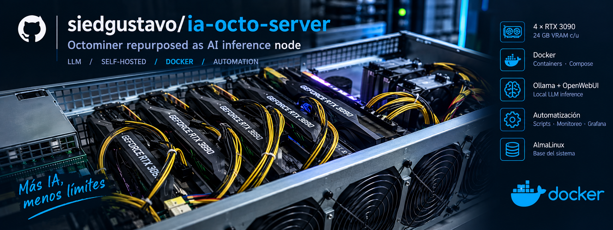

# Octoserver · From mining rig to local AI

**Four RTX 3090s. 96 GiB of VRAM. A second life for an Octominer.**

[](#the-hardware)
[](#the-hardware)
[](#services)
[](#what-it-does)

A mining chassis gets a new job: running large language models locally, with its
own cooling control, hardware watchdog, live dashboards and an OLED status display.
**The GPUs do the inference. The rest of the stack keeps the machine running.**

This repository contains the Octofan AI Server stack, hardware notes and performance
experiments behind Octoserver. Including the experiments that proved our first
explanation wrong.

**[Explore the benchmarks](#measured-not-just-built)** ·
**[Get started](#quick-start)** ·
**[Read the architecture](docs/architecture.md)** ·
**[Browse the docs](#documentation)**

## Measured, not just built

Results recorded through November 23, 2026, with all four GPU links at PCIe Gen3
x8:

| Workload | Result | What it means |
|---|---:|---|
| Huihui Qwen3.8-Flash-Next abliterated V2, Strata 0.2.20, ~114k prompt | **4732 tokens/s** prompt · **115 tokens/s** generation | The daily inference service (MTP speculative decoding + expert cache, GPUs capped at 250 W); 147–165 tokens/s on short prompts. A 114k-token request finishes in 29 s |
| Same model and settings, Strata 0.2.7, ~114k prompt | **1404 tokens/s** prompt · **98 tokens/s** generation | The previous engine, measured the same day: 0.2.20 decodes 15–25% faster and reads prompts 2–3.4× faster |
| DeepSeek-V4.1-Flash abliterated Mix-128G, Project Maya, ~8.5k prompt | **1008 tokens/s** prompt · **43.5 tokens/s** generation | The on-demand 1M-context model with vision, fully in VRAM + RAM |
| gpt-oss-120b MXFP4, Ollama, ~2k prompt | **104 tokens/s** generation | A 120B-class model running entirely on the GPUs (Ollama was retired on 2026-11-19) |
| Qwen3.8-Flash-Next, llama.cpp b11381, ~4k prompt | **634 tokens/s** prompt · **58 tokens/s** generation | The former dedicated llama.cpp service |
| GLM-5.3-Flash IQ1_S, auto-fit, ~4k prompt | **227 tokens/s** prompt · **21.5 tokens/s** generation | A larger MoE model using GPU memory plus CPU offload |

The two Strata rows are a same-day A/B with the same model files and arguments
([Strata notes](docs/strata-qwen.md)). The other rows were measured on different
dates and engines, so read them as configurations, not an engine shootout.

### How does it compare with a DGX Spark?

Our gpt-oss-120b run recorded **104 tokens/s**, versus **58.7 tokens/s** in the
published llama.cpp DGX Spark reference: an observed **1.8× difference**.

That's a compelling result for repurposed hardware, but **not a controlled
hardware shootout**: our run used Ollama and its GGUF conversion; the Spark
reference used llama-bench, a different build and different context handling.
These measurements do not establish a universal speed advantage. Nor do they
establish a tokens-per-watt winner: our power samples were not synchronized with
a matching Spark measurement.

**[Read the comparison, measurements and limitations →](docs/octoserver-vs-dgx-spark.md)**

### The tuning lessons were just as useful

- **New risers helped, but tensor split still lost.** Layer split delivered
  2.26× the prompt throughput and 2.54× the generation throughput of the tested
  tensor configuration. [Results →](docs/qwen38flash-split-benchmark.md)
- **More GPUs only help if their memory gets used.** One manual GLM placement
  left GPU 0 and GPU 1 almost empty. Auto-fit made substantially better use of
  the available VRAM. [Results →](docs/glm53flash-benchmark.md)
- **Capacity and speed are different constraints.** A model fitting entirely
  on the GPUs behaves very differently from one that needs CPU offload. DeepSeek
  Mix-128G fits in VRAM + RAM; Mix-256G streams experts from the SSD and runs
  about 4× slower. [Results →](docs/maya-deepseek.md)
- **Long context is where engines differ.** llama.cpp v1.0.0 with MTP matches
  Strata on short prompts, but at 111k tokens Strata still decodes 2× faster.
  [Results →](docs/llamacpp-v1-vs-strata.md)
- **The power cap costs almost nothing.** Lifting the 250 W per-GPU cap left
  decode unchanged and made long prompts only 3–6% faster, so the cap stays.
  The DFlash2 drafter beat MTP on short prompts but lost 5–8% decode on long
  ones, so MTP stays. [Results →](docs/strata-qwen.md)

## The hardware

| Component | Octoserver |
|---|---|
| Chassis | Repurposed Octominer / Octofan mining enclosure |
| GPUs | **4 × NVIDIA RTX 3090**, 24 GiB each, Ampere, power-capped at 250 W each |
| GPU links | PCIe Gen3 x8 per card, direct CPU root ports |
| GPU peer-to-peer | Unavailable in the measured configuration |
| CPU | 2 × Intel Xeon E5-2680 v4, 28 cores / 56 threads total |
| Host memory | Approximately 125 GiB reported by the OS |
| Storage | Samsung 980 PRO 2 TB NVMe |
| Power | Octominer PSU plus a 120 W pico ATX for the 24-pin board connector ([hardware mods](docs/hardware-mods.md)) |
| OS | AlmaLinux 10.1 |
| Deployment | Docker Compose; Strata (daily) and Maya (on demand) swapped by llama-swap, plus dedicated llama.cpp benchmark stacks |

The 96 GiB of VRAM is distributed across four cards, not a single unified memory
pool. Model placement, KV cache and temporary buffers all matter.

## More than a model server

The stack keeps the original `fan_controller_cli` binary as the hardware interface
and replaces the HiveOS scripts with a Python/FastAPI controller, Prometheus
metrics and provisioned Grafana dashboards. It connects inference software to the
physical machine: temperatures, power supplies, fans, LEDs and watchdog recovery.

The original HiveOS package files are preserved as reference material under
`reference/octofan-hiveos-originals/`.

## What It Does

- Reads Octofan controller telemetry through the original USB CLI.
- Controls chassis fans from intake, exhaust and intake-to-exhaust delta temperatures, with a capped assist from the hottest GPU.
- Exposes all controller telemetry as Prometheus metrics.
- Adds NVIDIA GPU telemetry from `nvidia-smi`, plus the GDDR6X memory temperature read from each card's BAR0 (GeForce cards report it as N/A).
- Adds host CPU, memory, disk and network telemetry through node exporter.
- Ships Grafana dashboards for overview, PSUs, environment, cooling, GPUs and host/network, plus Prometheus alert rules for GPU inventory, `nvidia-smi` availability, frozen GPU readings, GPU core and memory temperature, watchdog health, and Strata/Flux availability.
- Updates the controller OLED with host, thermal, power and AI status.
- Drives the front-panel LEDs from controller health and GPU activity.
- Feeds two hardware watchdogs only when configured host checks (TCP, HTTP, SSH banner or a disk write+fsync heartbeat) and the GPU inventory condition pass: the chipset iTCO (`/dev/watchdog`), which resets the host about 3 minutes after feeding stops, and the Octofan firmware watchdog (its reset cable is disconnected since 2026-11-16, see [watchdog decisions](docs/watchdog-power-cycle.md)).
- Restarts the running inference container when its API stops answering or a GPU drops out, before any board reset.
- Serves LLM inference on all four GPUs: Strata (Qwen) for daily use and Maya (DeepSeek) on demand, one at a time, swapped by llama-swap.

## Services

Main `docker-compose.yml`:

- `octofan-controller`: FastAPI daemon, UI, REST API, Prometheus exporter, fan control, watchdog and OLED updates.
- `prometheus`: metrics storage and alert rules (`prometheus/rules/`).
- `node-exporter`: host system and network metrics, running in the host network namespace.
- `grafana`: dashboard at `http://localhost:3000` (`admin` / `octofan`).

Dedicated stacks, started with `-f`. `strata-qwen`, `qwen38flash` and `glm53flash` share
the main Compose project (see the `--remove-orphans` warning in `docs/operations.md`);
`maya-deepseek` and `flux` are separate Compose projects:

- `strata-qwen`: Strata 0.2.20 serving Huihui Qwen3.8-Flash-Next abliterated V2 on port `18080` (OpenAI-compatible, no API key), defined in `docker-compose.strata-qwen.yml`. **The daily inference service since 2026-10-31**, and the model llama-swap preloads after a reboot. Text only, one request slot, native 262,144-token context. The controller polls its `/v1/models` for OLED/LED/status health and restarts the container when it stops answering. See `docs/strata-qwen.md`.
- `maya-deepseek`: Project Maya serving DeepSeek-V4.1-Flash abliterated (Mix-128G, 1M context, vision) on port `18090`, defined in `docker-compose.maya-deepseek.yml` (own Compose project `octofan-maya`). Started on demand. See `docs/maya-deepseek.md`.
- `llama-swap` (host systemd service, port `18100`, config `llama-swap/config.yaml`): starts Strata or Maya according to the requested `model` and stops the other. Only OpenCode goes through it; never start or stop those two stacks by hand. See `docs/model-swap.md`.
- `qwen38flash`: dedicated llama.cpp service on port `8091`, defined in `docker-compose.qwen38flash.yml`. Not deployed at the moment; kept to reproduce benchmarks.
- `glm53flash`: dedicated llama.cpp service on port `8090`, defined in `docker-compose.glm53flash.yml`. Not deployed at the moment; kept to reproduce benchmarks.
- `flux`: CPU-only FLUX.1-schnell image generation (stable-diffusion.cpp `sd-server`) on port `7860`, defined in `docker-compose.flux.yml` as its own Compose project (`octofan-flux`). Health-polled by the controller (`octofan_flux_up`). See `docs/operations.md`.

The GPU inference services compete for the same GPU memory and must run one at
a time. The benchmarks above ran them individually.

## Repository Layout

- `controller/`: Python FastAPI controller service.
- `config/octofan.yaml`: mounted runtime configuration.
- `grafana/`: provisioned datasource and dashboards.
- `prometheus/`: scrape configuration and alert rules.
- `reference/octofan-hiveos-originals/`: original HiveOS files retained for reference.
- `tests/`: parser, fan control, display, watchdog, host watchdog, NVIDIA, Strata, Flux, llama.cpp, compose and API tests.
- `llamacpp/`: dedicated llama.cpp images and KV-cache persistence entrypoint.
- `ollama/`, `ollama-custom/`: Modelfiles, Dockerfile and patches of the retired Ollama service, kept as a recipe (`ollama-custom/README.md`).
- `maya/`: Maya engine configuration.
- `llama-swap/`: llama-swap configuration for the Strata/Maya swap.
- `strata/`: Strata engine configuration.
- `scripts/`: model download helpers (Maya DeepSeek, FLUX, the planned DeepSeek V4 import) and `bench-openai-timings.py`, the benchmark used for the Strata, Maya and llama.cpp comparisons.
- `host/`: host-level sysctl tuning.
- `docs/`: benchmarks, hardware investigations and operating notes.
- `tools/expert-profiler/`: MoE expert profiling experiments.

## Quick Start

Optional: copy `.env.example` to `.env` and adjust ports or mock mode.

```bash
docker compose up --build
```

Open:

- Controller UI: `http://localhost:8000`
- Prometheus: `http://localhost:9090`
- Grafana: `http://localhost:3000`

Grafana provisions these dashboards under the `Octofan` folder:

- `Octofan - Overview`
- `Octofan - Power Supplies`
- `Octofan - Environment`
- `Octofan - Cooling`
- `Octofan - GPUs`
- `Octofan - Host and Network`

To test without Octofan hardware:

```bash
OCTOFAN_MOCK=1 docker compose up --build
```

If the default UI ports are already in use:

```bash
OCTOFAN_MOCK=1 OCTOFAN_CONTROLLER_PORT=18000 PROMETHEUS_PORT=19090 GRAFANA_PORT=13000 docker compose up --build
```

## AlmaLinux 10 Notes

The controller container is privileged and mounts `/dev/bus/usb` because the original CLI uses libusb to talk to the Octofan controller. Keep the stack on a trusted LAN; v1 intentionally has no authentication on the controller UI/API.

Configuration lives in `config/octofan.yaml`.

## Configuration

The controller watches the mounted YAML at startup. Restart `octofan-controller` after manual edits:

```bash
docker compose restart octofan-controller
```

Important sections:

- `fans`: auto/manual mode, target temperature, min/max fan limits and fail-safe speed.
- `watchdog`: firmware watchdog timeouts, the chipset watchdog (`host_device`, `host_timeout_seconds`), TCP/HTTP/SSH/disk health checks, expected GPU count, and GPU/AI container recovery before a reset. `POST /api/watchdog/maintenance` keeps feeding for up to 240 minutes during planned work.
- `display`: OLED profile and refresh interval.
- `leds`: front-panel LED policy. By default LED `0` is orange warning, LED `1` is blue online and LED `2` is white activity.
- `llamacpp`: optional legacy health polling; disabled in production.
- `ollama`: legacy health polling for the retired Ollama service (`enabled`, `base_url`, `timeout_seconds`); `enabled: false` in production.
- `strata`: inference health polling for the daily service (`enabled`, `base_url`, `endpoints`, `timeout_seconds`). `endpoints` lists Strata (`:18080`) and Maya (`:18090`): the backend is up when either answers `/v1/models`. It is reflected in `/api/status`, the OLED `ai` profile and the online/warning LEDs, and the watchdog's AI recovery restarts whichever of `strata-qwen` / `maya-deepseek` is running on persistent failure.
- `flux`: image-generation health polling (`enabled`, `base_url` → `http://host.docker.internal:7860`, `timeout_seconds`). Reported in `/api/status` and `octofan_flux_up` only.

Automatic fan control combines BME280 intake, exhaust, exhaust-minus-intake delta and a capped
hottest-GPU assistance curve, then applies the highest demand. Chassis temperatures govern normal
airflow; GPU temperature only contributes above 75C and cannot request more than 40% before the
88C emergency threshold. Invalid sensors are filtered independently, while critical temperatures
override normal slew limits. The API, Prometheus and Cooling dashboard expose each signal's demand.

`fans.gpu_idle_stop_enabled` can hold the chassis fans at the lowest active configured speed while NVIDIA GPUs are idle and cool. Manual and automatic targets are clamped to `fans.min_percent..fans.max_percent`, and the idle policy falls back to the normal auto curve when GPU load, GPU temperature, intake temperature or telemetry health no longer matches the configured idle thresholds.

The OLED `ai` profile shows a large title taken from the host name (`OCTOSERVER`, or `display.title`), the host IP, AI health (whichever of Strata or Maya answers, as `Strata 1/1 loaded` / `Maya 1/1 loaded`, or `Strata DOWN`; the legacy backends show `Ollama N loaded`, `AI services OK` or `AI monitor off`), hottest-GPU temperature and load, intake temperature with the current fan percent, and total power. The host IP is auto-detected from the host hostname and `/etc/hosts` (both mounted read-only into the controller); set `OCTOFAN_DISPLAY_IP` in `.env` to pin a specific address.

## API

- `GET /api/status`
- `GET /api/config`
- `PUT /api/config`
- `POST /api/fans/manual`
- `POST /api/fans/auto`
- `POST /api/display/render`
- `POST /api/watchdog/test`
- `POST /api/watchdog/maintenance`
- `POST /api/calibrate-fans`
- `GET /metrics`

## Ollama (retired)

Ollama was removed from octoserver on 2026-11-19: the `ollama` service left
`docker-compose.yml` and its container, images and `/opt/ollama` were deleted.
Strata replaced it as the daily service on 2026-10-31, and Maya covers DeepSeek.

- The model store is archived cold on inference2: see
  [Ollama store archive](docs/ollama-store-archive.md) for tags, verification and restore.
- `ollama-custom/` (Dockerfile + patches) and the Modelfiles in `ollama/` stay as a recipe;
  `ollama-custom/README.md` explains how to bring the service back from git history
  (`git log -S "octofan-ollama" -- docker-compose.yml`).
- Never run it next to Strata or Maya: they all need the four GPUs.

Other cold archives: GLM-5.3 models ([GLM models archive](docs/glm-models-archive.md)) and the
legacy llama.cpp coder models ([llama.cpp models archive](docs/llamacpp-models-archive.md)).

## Validation

Run tests locally:

```bash
python3 -m venv .venv
.venv/bin/pip install -r controller/requirements.txt pytest
.venv/bin/python -m pytest -q
```

Validate the compose file:

```bash
docker compose config
```

Test the full stack without hardware:

```bash
OCTOFAN_MOCK=1 docker compose up --build
```

## Documentation

- [Architecture](docs/architecture.md)
- [Operations](docs/operations.md)
- [API and metrics](docs/api-and-metrics.md)
- [Strata daily inference service](docs/strata-qwen.md)
- [DeepSeek-V4.1-Flash with Project Maya](docs/maya-deepseek.md)
- [Strata/Maya model swap with llama-swap](docs/model-swap.md)
- [llama.cpp v1.0.0 vs Strata](docs/llamacpp-v1-vs-strata.md)
- [GLM-5.3-Flash tuning and lessons](docs/glm53flash-benchmark.md)
- [Qwen3.8-Flash-Next split benchmark](docs/qwen38flash-split-benchmark.md)
- [Octoserver vs NVIDIA DGX Spark](docs/octoserver-vs-dgx-spark.md)
- [KV-cache persistence for the dedicated llama.cpp stacks](docs/kv-cache-persistence.md)
- [GLM-5.3-Flash expert affinity](docs/glm53flash-expert-affinity.md) and [ktransformers POC](docs/glm53flash-ktransformers-poc.md)
- [Hardware mods](docs/hardware-mods.md)
- [Watchdog and power-cycle decisions](docs/watchdog-power-cycle.md)
- [NVMe drops and the worn pico ATX (2026-11-16 incident)](docs/incidente-2026-11-16-nvme-pico-atx.md)
- Cold model archives: [Ollama store](docs/ollama-store-archive.md), [GLM models](docs/glm-models-archive.md), [llama.cpp models](docs/llamacpp-models-archive.md)

Most operating notes and benchmark write-ups are in Spanish; the README, architecture, operations and API docs are in English.
