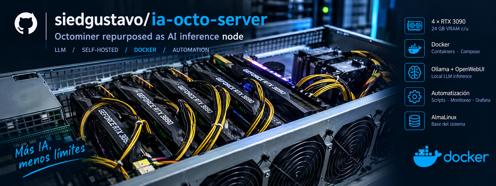

# Octoserver · From mining rig to local AI

**Four RTX 3090s. 96 GiB of VRAM. A second life for an Octominer.**

[](#the-hardware)
[](#the-hardware)
[](#services)
[](#what-it-does)

A mining chassis gets a new job: running large language models locally, with its
own cooling control, hardware watchdog, live dashboards and an OLED status display.
**The GPUs do the inference. The rest of the stack keeps the machine running.**

This repository contains the Octofan AI Server stack, hardware notes and performance
experiments behind Octoserver. Including the experiments that proved our first
explanation wrong.

**[Explore the benchmarks](#measured-not-just-built)** ·
**[Get started](#quick-start)** ·
**[Read the architecture](docs/architecture.md)** ·
**[Browse the docs](#documentation)**

## Measured, not just built

Results recorded through October 31, 2026, with all four GPU links at PCIe Gen3
x8:

| Workload | Result | What it means |
|---|---:|---|
| gpt-oss-120b MXFP4, Ollama, ~2k prompt | **104 tokens/s** generation | A 120B-class model running entirely on the GPUs |
| Huihui Qwen3.8-Flash-Next abliterated V2, Strata 0.2.7, ~6.8k prompt | **1286 tokens/s** prompt · **96–128 tokens/s** generation | The current daily inference service (MTP speculative decoding + expert cache); median 101 tokens/s over 24 h of real mixed use |
| Qwen3.8-Flash-Next, llama.cpp b11381, ~4k prompt | **634 tokens/s** prompt · **58 tokens/s** generation | The former dedicated llama.cpp service, later served through custom Ollama; long-context decode improves more |
| GLM-5.3-Flash IQ1_S, auto-fit, ~4k prompt | **227 tokens/s** prompt · **21.5 tokens/s** generation | A larger MoE model using GPU memory plus CPU offload |

The Strata figures come from a configuration comparison, not an engine shootout
with identical optimizations: see [Strata notes](docs/strata-qwen.md).

### How does it compare with a DGX Spark?

Our gpt-oss-120b run recorded **104 tokens/s**, versus **58.7 tokens/s** in the
published llama.cpp DGX Spark reference: an observed **1.8× difference**.

That's a compelling result for repurposed hardware, but **not a controlled
hardware shootout**: our run used Ollama and its GGUF conversion; the Spark
reference used llama-bench, a different build and different context handling.
These measurements do not establish a universal speed advantage. Nor do they
establish a tokens-per-watt winner: our power samples were not synchronized with
a matching Spark measurement.

**[Read the comparison, measurements and limitations →](docs/octoserver-vs-dgx-spark.md)**

### The tuning lessons were just as useful

- **New risers helped, but tensor split still lost.** Layer split delivered
  2.26× the prompt throughput and 2.54× the generation throughput of the tested
  tensor configuration. [Results →](docs/qwen38flash-split-benchmark.md)
- **More GPUs only help if their memory gets used.** One manual GLM placement
  left GPU 0 and GPU 1 almost empty. Auto-fit made substantially better use of
  the available VRAM. [Results →](docs/glm53flash-benchmark.md)
- **Capacity and speed are different constraints.** A model fitting entirely
  on the GPUs behaves very differently from one that needs CPU offload.

## The hardware

| Component | Octoserver |
|---|---|
| Chassis | Repurposed Octominer / Octofan mining enclosure |
| GPUs | **4 × NVIDIA RTX 3090**, 24 GiB each, Ampere |
| GPU links | PCIe Gen3 x8 per card, direct CPU root ports |
| GPU peer-to-peer | Unavailable in the measured configuration |
| CPU | 2 × Intel Xeon E5-2680 v4, 28 cores / 56 threads total |
| Host memory | Approximately 125 GiB reported by the OS |
| Storage | Samsung 980 PRO 2 TB NVMe |
| Deployment | Docker Compose; Strata (daily), Ollama (fallback) and dedicated llama.cpp benchmark stacks |

The 96 GiB of VRAM is distributed across four cards, not a single unified memory
pool. Model placement, KV cache and temporary buffers all matter.

## More than a model server

The stack keeps the original `fan_controller_cli` binary as the hardware interface
and replaces the HiveOS scripts with a Python/FastAPI controller, Prometheus
metrics and provisioned Grafana dashboards. It connects inference software to the
physical machine: temperatures, power supplies, fans, LEDs and watchdog recovery.

The original HiveOS package files are preserved as reference material under
`reference/octofan-hiveos-originals/`.

## What It Does

- Reads Octofan controller telemetry through the original USB CLI.
- Controls chassis fans from internal case temperature.
- Exposes all controller telemetry as Prometheus metrics.
- Adds NVIDIA GPU telemetry from `nvidia-smi`.
- Adds host CPU, memory, disk and network telemetry through node exporter.
- Ships Grafana dashboards for overview, PSUs, environment, cooling, GPUs and host/network, plus Prometheus alert rules for GPU inventory, frozen GPU readings, GPU temperature and controller availability.
- Updates the controller OLED with host, thermal, power and AI status.
- Drives the front-panel LEDs from controller health and GPU activity.
- Feeds the hardware watchdog only when configured host checks (TCP, HTTP or SSH banner) and the GPU inventory condition pass; the firmware pulses the motherboard RESET line when feeding stops.
- Serves LLM inference on all four GPUs: Strata for daily use, Ollama kept as a stopped fallback.

## Services

Main `docker-compose.yml`:

- `octofan-controller`: FastAPI daemon, UI, REST API, Prometheus exporter, fan control, watchdog and OLED updates.
- `prometheus`: metrics storage and alert rules (`prometheus/rules/`).
- `node-exporter`: host system and network metrics, running in the host network namespace.
- `grafana`: dashboard at `http://localhost:3000` (`admin` / `octofan`).
- `ollama`: Ollama API at `http://localhost:11434`, with every host GPU visible, built from `ollama-custom/Dockerfile`. **Stopped in production as a fallback** while Strata owns the GPUs; it lives behind the Compose profile `ollama` so a bare `docker compose up -d` never starts it.

Dedicated Compose files (same Compose project, started with `-f`; see the
`--remove-orphans` warning in `docs/operations.md`):

- `strata-qwen`: Strata serving Huihui Qwen3.8-Flash-Next abliterated V2 on port `18080` (OpenAI-compatible, no API key), defined in `docker-compose.strata-qwen.yml`. **The daily inference service since 2026-10-31.** The controller polls its `/v1/models` for OLED/LED/status health and auto-restarts the container when it stops answering. See `docs/strata-qwen.md`.
- `qwen38flash`: dedicated llama.cpp service on port `8091`, defined in `docker-compose.qwen38flash.yml`. Not deployed at the moment; kept to reproduce benchmarks.
- `glm53flash`: dedicated llama.cpp service on port `8090`, defined in `docker-compose.glm53flash.yml`. Not deployed at the moment; kept to reproduce benchmarks.
- `flux`: CPU-only FLUX.1-schnell image generation (stable-diffusion.cpp `sd-server`) on port `7860`, defined in `docker-compose.flux.yml` as its own Compose project (`octofan-flux`). Health-polled by the controller (`octofan_flux_up`). See `docs/operations.md`.

The GPU inference services compete for the same GPU memory and must run one at
a time. The benchmarks above ran them individually.

## Repository Layout

- `controller/`: Python FastAPI controller service.
- `config/octofan.yaml`: mounted runtime configuration.
- `grafana/`: provisioned datasource and dashboards.
- `prometheus/`: scrape configuration and alert rules.
- `reference/octofan-hiveos-originals/`: original HiveOS files retained for reference.
- `tests/`: parser, control, display, watchdog, compose and API tests.
- `llamacpp/`: dedicated llama.cpp images and KV-cache persistence entrypoint.
- `ollama/`: model manifests (Modelfiles) for the Ollama service.
- `ollama-custom/`: Dockerfile and patches for the custom Ollama image (`num_ubatch`, context-shift pin, `--cache-ram`).
- `strata/`: Strata engine configuration.
- `scripts/`: model download helpers.
- `host/`: host-level sysctl tuning.
- `docs/`: benchmarks, hardware investigations and operating notes.
- `tools/expert-profiler/`: MoE expert profiling experiments.

## Quick Start

Optional: copy `.env.example` to `.env` and adjust ports or mock mode.

```bash
docker compose up --build
```

Open:

- Controller UI: `http://localhost:8000`
- Prometheus: `http://localhost:9090`
- Grafana: `http://localhost:3000`
- Ollama: `http://localhost:11434`

Grafana provisions these dashboards under the `Octofan` folder:

- `Octofan - Overview`
- `Octofan - Power Supplies`
- `Octofan - Environment`
- `Octofan - Cooling`
- `Octofan - GPUs`
- `Octofan - Host and Network`

To test without Octofan hardware:

```bash
OCTOFAN_MOCK=1 docker compose up --build
```

If the default UI ports are already in use:

```bash
OCTOFAN_MOCK=1 OCTOFAN_CONTROLLER_PORT=18000 PROMETHEUS_PORT=19090 GRAFANA_PORT=13000 docker compose up --build
```

## AlmaLinux 10 Notes

The controller container is privileged and mounts `/dev/bus/usb` because the original CLI uses libusb to talk to the Octofan controller. Keep the stack on a trusted LAN; v1 intentionally has no authentication on the controller UI/API.

Configuration lives in `config/octofan.yaml`.

## Configuration

The controller watches the mounted YAML at startup. Restart `octofan-controller` after manual edits:

```bash
docker compose restart octofan-controller
```

Important sections:

- `fans`: auto/manual mode, target temperature, min/max fan limits and fail-safe speed.
- `watchdog`: hardware watchdog timeouts, TCP/HTTP/SSH health checks, expected GPU count and container recovery before the firmware escalates.
- `display`: OLED profile and refresh interval.
- `leds`: front-panel LED policy. By default LED `0` is orange warning, LED `1` is blue online and LED `2` is white activity.
- `llamacpp`: optional legacy health polling; disabled when Ollama is the only inference service.
- `ollama`: on-demand inference health polling (`enabled`, `base_url`, `timeout_seconds`). Disabled in production while the fallback container is stopped.
- `strata`: inference health polling for the daily service (`enabled`, `base_url` → `http://host.docker.internal:18080`, `timeout_seconds`). When enabled, the controller polls `/v1/models` and reflects it in `/api/status`, the OLED `ai` profile and the online/warning LEDs, and the watchdog's AI recovery restarts `strata-qwen` on persistent failure.
- `flux`: image-generation health polling (`enabled`, `base_url` → `http://host.docker.internal:7860`, `timeout_seconds`). Reported in `/api/status` and `octofan_flux_up` only.

Automatic fan control combines BME280 intake, exhaust, exhaust-minus-intake delta and a capped
hottest-GPU assistance curve, then applies the highest demand. Chassis temperatures govern normal
airflow; GPU temperature only contributes above 75C and cannot request more than 40% before the
88C emergency threshold. Invalid sensors are filtered independently, while critical temperatures
override normal slew limits. The API, Prometheus and Cooling dashboard expose each signal's demand.

`fans.gpu_idle_stop_enabled` can hold the chassis fans at the lowest active configured speed while NVIDIA GPUs are idle and cool. Manual and automatic targets are clamped to `fans.min_percent..fans.max_percent`, and the idle policy falls back to the normal auto curve when GPU load, GPU temperature, intake temperature or telemetry health no longer matches the configured idle thresholds.

The OLED `ai` profile shows the host IP, AI health (`Strata N/N loaded`, `Strata DOWN`, `Ollama N loaded`, `Ollama DOWN`, `AI services OK` or `AI monitor off`, preferring Strata, then Ollama, then llama.cpp), hottest-GPU temperature and load, intake temperature with the current fan percent, and total power. The host IP is auto-detected from the host hostname and `/etc/hosts` (both mounted read-only into the controller); set `OCTOFAN_DISPLAY_IP` in `.env` to pin a specific address.

## API

- `GET /api/status`
- `GET /api/config`
- `PUT /api/config`
- `POST /api/fans/manual`
- `POST /api/fans/auto`
- `POST /api/display/render`
- `POST /api/watchdog/test`
- `POST /api/watchdog/maintenance`
- `POST /api/calibrate-fans`
- `GET /metrics`

## Ollama

> In production Ollama is currently **stopped** (`docker stop octofan-ollama`) while Strata
> serves the GPUs. The service sits behind the Compose profile `ollama`: a bare
> `docker compose up -d` ignores it, and a start requires
> `docker compose --profile ollama up -d ollama` (or `docker start octofan-ollama`) after
> stopping `strata-qwen`. See `docs/strata-qwen.md`.

The stack includes one custom Ollama instance with every NVIDIA GPU on the host visible. It processes one request
per model in parallel, packs a model into one GPU whenever it fits, uses an 8-bit KV cache to
reduce context memory, and uses `OLLAMA_KEEP_ALIVE=-1` so loaded models remain resident indefinitely.
Ollama can still evict them when another model needs their VRAM. Request-level `keep_alive` can override
this default. Models that do not fit in one card are still
split across the available GPUs automatically. Compose uses `gpus: all`, so adding or removing a card does
not require maintaining a list of GPU indices. The image is built from `ollama-custom/Dockerfile`
(Ollama 0.35.1 with llama.cpp b11381 and three patches: a separate `num_ubatch` option, a
server-wide context-shift pin via `OLLAMA_CONTEXT_SHIFT`, and a host-RAM prompt cache via
`OLLAMA_CACHE_RAM_MIB`).

Ollama stores its active model inventory under `${OLLAMA_DATA_DIR:-/opt/ollama}`. Cold GGUF files live under `${MODELS_ARCHIVE_DIR:-/opt/models-archive}`, mounted read-only at `/models-archive`, and can be registered without downloading them again:

```bash
docker compose up -d ollama
docker compose exec ollama ollama create qwen3.8-flash-next:176b -f /model-definitions/qwen3.8-flash-next.Modelfile
docker compose exec ollama ollama create qwen3.8-flash-next-uncensored:176b -f /model-definitions/qwen3.8-flash-next-uncensored.Modelfile
docker compose exec ollama ollama list
```

Each installed model pins its context in its own manifest; there is no container-wide context override. Interactive models use their native maximum and are never configured below 128k. The dedicated `mistral-medium-3.5:128b` writing model is the exception: sied-poster caps scraped input at 8,000 characters and requests at most 4,096 output tokens, so its IQ2_S manifest uses 32k to keep more layers on the GPUs. The DeepSeek manifest also sets `num_batch=128` and `repeat_penalty=1.0` to avoid the large sampler overhead measured on large vocabularies. Qwen3.8-Flash-Next pins `num_batch=512`, `num_ubatch=256`, and the production layer split (`tensor_split 0.9,1,1,1.1`) in its own manifest. Other models can be added with `ollama pull`, and Ollama loads them only when requested:

Qwen3.8-Flash-Next vision depends on the separate Unsloth
`UD-Q4_K_XL/mmproj-F16.gguf` projector. Its Modelfile imports the projector with
an additional `FROM`; without it, Ollama registers a text-only model and rejects
images. See [Qwen3.8-Flash-Next vision support](docs/operations.md#qwen38-flash-next-vision-support)
for diagnosis, model recreation, and an end-to-end image test.

`qwen3.8-flash-next-uncensored:176b` is the abliterated build from
`orcarouter/Qwen3.8-Flash-Next-Uncensored-GGUF` (gated; downloaded with the
`HF_TOKEN` from `.env`). It uses `Q4_K_S`, the closest size to the stock
`UD-Q4_K_XL`, plus its own mmproj, and copies the stock manifest's parameters
verbatim. Both 176b variants fill the four GPUs, so Ollama swaps them on demand.

```bash
docker compose exec ollama ollama pull gemma3
curl http://localhost:11434/api/chat -d '{
  "model": "gemma3",
  "messages": [{"role": "user", "content": "Hello"}],
  "stream": false
}'
docker compose exec ollama ollama ps
```

The scheduler can distribute a model across all visible GPUs and unload idle models when another request needs their VRAM.

The installed inventory uses `name:parameter-count` tags (production, 2026-10-31):

```bash
gpt-oss:120b
mistral-medium-3.5:128b
qwen3-coder-next:80b
qwen3.8:27b-q8_0
qwen3.8-uncensored:27b
qwen3.8-flash-next:176b
qwen3.8-flash-next-uncensored:176b
```

`gpt-oss:120b` and `qwen3.8-uncensored:27b` were pulled/created directly and have
no Modelfile in `ollama/`.

`ollama/deepseek-v4-flash-284b.Modelfile` and `scripts/download-deepseek-v4-flash.sh`
describe a planned DeepSeek V4 Flash import (native 1,048,576-token context,
`num_batch=128`, `repeat_penalty=1.0`). The model is **not installed** in
production: no shards are staged and no `deepseek-v4-flash` tag is registered.
Note that the script downloads `UD-IQ2_M` into `MODELS_DIR`, while
`docs/operations.md` describes a `UD-Q8_K_XL` staging under `/opt/models-archive`;
reconcile the quantization and path before importing. Either way the model
needs all four GPUs plus host RAM, so expect partial CPU offload.

Reapply a model's configured context through a temporary manifest without changing its stable tag:

```bash
docker compose exec ollama ollama create qwen3-coder-next:configured \
  -f /model-definitions/qwen3-coder-next-80b.Modelfile
docker compose exec ollama ollama cp qwen3-coder-next:configured qwen3-coder-next:80b
docker compose exec ollama ollama rm qwen3-coder-next:configured
```

When weights plus KV cache do not fit on one GPU, Ollama spreads the GPU-resident portion across
the visible cards and offloads the remainder to host RAM. Loading this
model can evict the smaller resident models; benchmark it before routing production traffic.

## Validation

Run tests locally:

```bash
python3 -m venv .venv
.venv/bin/pip install -r controller/requirements.txt pytest
.venv/bin/python -m pytest -q
```

Validate the compose file:

```bash
docker compose config
```

Test the full stack without hardware:

```bash
OCTOFAN_MOCK=1 docker compose up --build
```

## Documentation

- [Architecture](docs/architecture.md)
- [Operations](docs/operations.md)
- [API and metrics](docs/api-and-metrics.md)
- [Strata daily inference service](docs/strata-qwen.md)
- [GLM-5.3-Flash tuning and lessons](docs/glm53flash-benchmark.md)
- [Qwen3.8-Flash-Next split benchmark](docs/qwen38flash-split-benchmark.md)
- [Octoserver vs NVIDIA DGX Spark](docs/octoserver-vs-dgx-spark.md)
- [KV-cache persistence for the dedicated llama.cpp stacks](docs/kv-cache-persistence.md)
- [GLM-5.3-Flash expert affinity](docs/glm53flash-expert-affinity.md) and [ktransformers POC](docs/glm53flash-ktransformers-poc.md)
- [Hardware mods](docs/hardware-mods.md)
- [Watchdog and power-cycle decisions](docs/watchdog-power-cycle.md)
